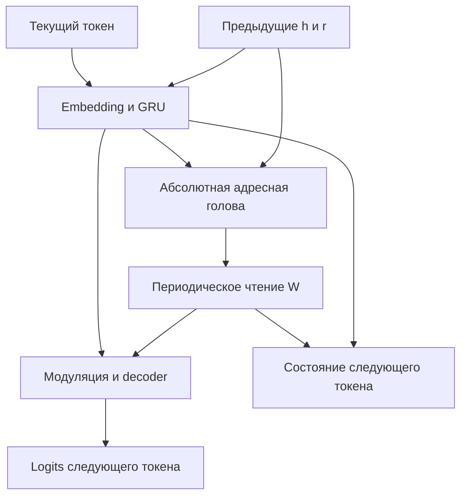

# Gemina — Mathematical and Interface Contracts

**Статус:** DRAFT / PROPOSED. **Дата:** 2026-11-02.  
Формулы и интерфейсы — предлагаемый исполнимый контракт, не принятый пользователем новый ADR. Математические выводы отделены от проверки официального исходника. Все проверки на Swift/MLX/Metal: **NOT_RUN**. [План](DETAILED-MVP-IMPLEMENTATION-PLAN.md) · [Протокол](TRAINING-EVALUATION-PROTOCOL.md).

## 1. Обозначения и формы

Используем строки batch; последняя ось — features. N=16, C=32; предлагаются H=128, d=32, словарь размера V=32. Индекс t — потреблённый токен, n — optimizer update. K зарезервирован для TBPTT, V_m — матрица модуляции, чтобы не смешивать её с размером словаря.

| Объект | Форма / dtype | Владение |
|---|---|---|
| W | [4096,32] FP32; логически [16,16,16,32] | SpatialField, обучаемые параметры |
| E | [V,d] FP32 | Embedding, параметры |
| X полной последовательности | [B,T+1] Int32 | Runner, данные |
| x_t / target_t | [B] Int32 | Вход step / только loss |
| h_t, p_t, r_t | [B,H], [B,3], [B,C] FP32 | AgentState вне Module |
| a_t=[e_t;r_prev] | [B,d+C] | Временный tensor |
| raw address u_t | [B,3] FP32 | Временный tensor головы |
| corner indices / λ | [B,8] Int32 / [B,8] FP32 | Sampler |
| gathered / read | [B,8,C] / [B,C] | Sampler |
| logits_t / sequence logits | [B,V] / [B,T,V] | Decoder / Runner |
| μ, per-position CE | [B,T] FP32 | Loss; μ не обучается |
| loss | scalar FP32 | Единственный скаляр дифференцирования |

B=1 не удаляет batch axis. Никакой общий hidden state между batch rows не допускается.

## 2. Reset и точный цикл R=1

До первого потребляемого токена:

$$h_0=0,\qquad p_0=(0.5,0.5,0.5),\qquad r_0=R(W,p_0).$$

p₀ одинаков для всех примеров и является предложенным начальным условием. В training начальное чтение вычисляется **внутри loss closure** после связывания параметров с autodiff. Иначе W→r₀→GRU может выпасть из градиента. На T токенов приходится T новых чтений плюс одно reset-чтение; тот же учёт действует для field-controls.

Для t=1…T:

$$e_t=E[x_t],\quad a_t=[e_t;r_{t-1}],\quad h_t=\operatorname{GRU}(a_t,h_{t-1}),$$

$$u_t=h_tM_h^\top+r_{t-1}M_r^\top+b_p,\qquad
p_t=\operatorname{wrap}_{16}(u_t),\qquad r_t=R(W,p_t),$$

$$c_t=h_tV_m^\top,\qquad m_t=(r_t\odot c_t)U^\top,$$
$$y_t=\tanh(h_t+m_t+b_y),\qquad \ell_t=y_tD^\top+b_o.$$

M_h:[3,H], M_r:[3,C], b_p:[3], V_m:[C,H], U:[H,C], b_y:[H], D:[V,H], b_o:[V]. Embedding и decoder не связывают веса.

Состояние выхода — (h_t,p_t,r_t); **y_t не записывается вместо h_t**. p_prev не добавляется к u и не поступает отдельным входом в baseline. Прошлое влияет через h и r. Нет ограничения длины перемещения, заданных смысловых областей или чтений узлов «между» последовательными адресами.

В столбцовой записи модуляция равна F(r)=I+U diag(r)V_m. F:[H,H] не строится: достаточно двух матричных умножений и покомпонентного произведения. Residual h сохраняет возможность обойти W; её необходимо измерять, а не устранять принудительной зависимостью decoder только от r.

### Точный вариант GRU

Предлагается использовать проверенный по исходнику MLX Swift reset-after вариант [S3]. Для gate q∈{g,z,n}: A_q:[H,d+C], B_q:[H,H], b_q:[H]; дополнительный c_n:[H].

$$g_t=\sigma(a_tA_g^\top+h_{t-1}B_g^\top+b_g),$$
$$z_t=\sigma(a_tA_z^\top+h_{t-1}B_z^\top+b_z),$$
$$\widetilde h_t=\tanh(a_tA_n^\top+b_n+
g_t\odot(h_{t-1}B_n^\top+c_n)),$$
$$h_t=(1-z_t)\odot\widetilde h_t+z_t\odot h_{t-1}.$$

Storage MLX: Wx:[3H,d+C], Wh:[3H,H], b:[3H], bhn:[H]; порядок блоков **reset, update, candidate**. Это не формула B_n(g⊙h_prev). Для одного токена встроенная GRU принимает [B,1,d+C] и hidden:[B,H], возвращает [B,1,H]; выбрать ровно временной индекс 0. Явный h₀=0 устраняет неоднозначность nil hidden.

## 3. Абсолютная координата и альтернативы

**Предлагаемый default:** affine u в единицах узлов и периодическое чтение. Это минимальная замена исторического bounded-step head. Производная по affine-output равна 1 внутри ячеек; дополнительного насыщения от выходной sigmoid нет. Возможность произвольного адреса означает отсутствие заданного ограничения относительно p_prev, а не гарантированное покрытие всего тора текущими параметрами.

| Вариант | Производная / достоинство | Ограничение и будущая проверка |
|---|---|---|
| u=affine; p=u−N floor(u/N) | Без saturating output, 3 выхода | Scale u, точность FP32, изломы; проверять вне граней и отдельно через шов |
| p=N sigmoid(z) | Диапазон; dp/dz=Nσ(1−σ) | Насыщение около 0/N и трудность перехода через выбранный шов; измерить saturation и градиент |
| p=N(tanh(z)+1)/2 | Аналогичный bounded chart; производная N(1−tanh²z)/2 | Та же проблема концов диапазона; это близкая параметризация sigmoid |
| p=N atan2(b,a)/(2π) modulo N, 2 выхода/ось | Явный угол, 6 выходов | Неопределённость в (0,0), градиент порядка N/(2π√(a²+b²)); проверить нормы пар и ε-policy |
| Историческое p=p_prev+0.5 tanh(…) modulo N | Контроль локального движения | Не реализует выбранный default свободной абсолютной адресации |

Если позднее понадобится explicit position feedback, использовать sin/cos по трём осям, [B,6], и пересчитать формы/число параметров. Сырой p как обычное число имеет разрыв у шва; в baseline он не возвращается в сеть. Эта дополнительная ветвь сейчас не нужна.

## 4. Периодический трилинейный sampler

### Контракт значения

Математически p=wrap_N(u)∈[0,N)³. Для вычисления **предлагается sampler непосредственно по raw u**; результат равен R(W,wrap_N(u)), но путь координатного градиента не зависит от floating remainder:

$$j=\lfloor u\rfloor,\qquad f=u-\operatorname{stopGradient}(j),$$
$$i=j-N\lfloor j/N\rfloor,\qquad q_b=(i+b)\bmod N,\quad b\in\{0,1\}^3,$$
$$\phi_0(f_d)=1-f_d,\quad \phi_1(f_d)=f_d,\quad
\lambda_b=\prod_{d=1}^3\phi_{b_d}(f_d),$$
$$r=\sum_b\lambda_b\,W_{q_b}.$$

i и q_b — **отсоединённая индексная ветвь**. Практически сначала выполнить положительное периодическое приведение j в float на отсоединённой ветви, затем привести i∈{0,…,15} к Int32; сосед +1 также завернуть 15→0. Это исключает signed remainder для отрицательных адресов и cast большой raw-координаты в Int32 до приведения. При NaN/Inf/индексе вне диапазона — остановка, не silent clamp.

Порядок углов: 000,001,010,011,100,101,110,111. Linear index:

$$\operatorname{flat}(q)=((q_xN)+q_y)N+q_z.$$

W reshaped [N³,C]; take по axis 0 с [B,8] индексами → [B,8,C]. Умножить на λ[...,None], суммировать по axis 1. Удаление channel или batch axis запрещено.

В точной арифметике f∈[0,1), λ≥0, Σλ=1. FP32 может округлить f почти на верхней грани до 1; проверка допускает этот endpoint с численным допуском. Canonical p для snapshot/Observer можно получить как i+f; возможное округлённое p=N нормализовать в 0. Это диагностическая координата, не новая графовая связь. r вычисляется из raw u и не заменяется повторным чтением canonical p в этом же step.

### Контракт производных

Для фиксированного адреса и upstream-vector v:

$$\frac{\partial r_c}{\partial W_{q_b,c'}}=\lambda_b\,\mathbf1_{c=c'},$$

$$\frac{\partial r}{\partial u_x}
=\sum_{b_y,b_z}\phi_{b_y}(f_y)\phi_{b_z}(f_z)
\left(W_{(i+(1,b_y,b_z))\bmod N}-W_{(i+(0,b_y,b_z))\bmod N}\right).$$

По y,z — аналогично. Повторные чтения узла разными углами, batch rows и токенами **суммируют** вклады. Const W даёт нулевой координатный градиент; это ожидаемый контроль, а не сбой autodiff.

Производная существует внутри ячеек. Значение через периодический шов непрерывно, но нормальная производная может различаться слева/справа, как на любой грани трилинейной сетки. На точной грани central difference не обязана совпадать с выбранной autodiff-ветвью. Требуются отдельные проверки значений и односторонних производных.

Jacobian одного чтения имеет форму C×3 и ранг не выше 3. Градиент сообщает о локальных разностях восьми узлов, не оценивает все далёкие непрочитанные области. Это аналитическое ограничение sampler; равномерная посещаемость не является обязательной целью.

## 5. Loss и граф

$$L=-\frac{\sum_{b,t}\mu_{bt}\log\operatorname{softmax}(\ell_{bt})[x_{b,t+1}]}
{\sum_{b,t}\mu_{bt}},\qquad M=\sum\mu>0.$$

В реализации — стабильная cross entropy от logits без предварительного softmax; reduction none → masked sum / M. Для первого fixed-length корпуса μ=1. Target поступает только в loss; на следующий step — в обычном teacher forcing.

Нужны все пути:

- текущий L→decoder→модуляция→r_t→W;
- L→r_t→u_t→address head и h_t;
- L→h_t→GRU/embedding;
- поздний L→перенос h/r→ранние чтения, head и W, включая r₀.

Полный BPTT строится **одним** loss closure на T, без stopGradient(h/r) внутри. Последовательный runner не может сначала вычислить всю GRU только из токенов: её вход содержит предыдущий r. Параметры постоянны до завершения градиента всего фрагмента.

По исходнику core [S7] valueAndGrad для нескольких outputs дифференцирует только первый, а auxiliary outputs отсоединяются. Поэтому возвращать state как aux допустимо для отчёта или TBPTT, но нельзя цепочкой таких вызовов получать якобы полный BPTT.

При frozen W исключить W из trainable/update, сохраняя coordinate-gradient sampler. stopGradient(r) уничтожил бы этот путь и сделал контроль некорректным.

## 6. Контракты компонентов и владение

Это спецификация операций, **не Swift-исходники или заглушки реализации**.

| Компонент / операция | Вход → выход | Мутации / ownership |
|---|---|---|
| SpatialField.weights | W:[4096,C] | Единственный leaf группы W: предлагаемый key `field.weights` |
| Sampler.read | W, raw:[B,3] → read:[B,C], p:[B,3]; опционально indices/λ | Stateless; без RNG и updates |
| Lion.update | token:[B], h/r → h:[B,H] | Embedding и GRU принадлежат Lion |
| AddressHead.address | h:[B,H], r_prev:[B,C] → raw:[B,3] | M_h/M_r/b_p принадлежат Lion |
| Decoder.decode | h,r → logits:[B,V] | U,V_m,b_y,D,b_o; h сохраняется |
| GeminaModel.reset / step | B → State; token,State → logits,new State | Собирает компоненты; state вне Module |
| SequenceRunner.loss | X:[B,T+1],μ:[B,T] → scalar loss, диагностические aux | Ни optimizer, ни чтение test; порядок t фиксирован |
| Trainer.trainBatch | model,batch,optimizer → loss/summary,new parameters | Единственный владелец update; две группы одного gradient tree |
| Checkpoint.save/restore | evaluated arrays + manifest ↔ validated fresh model/optimizer | Только границы завершённых updates |
| SessionSnapshot / replay | versioned state или полный префикс → состояние | Не обучает параметры; несовместимые версии отклоняет |
| Observer.receive | скопированный evaluated summary | Не удерживает MLX training graph, не меняет модель |

Корневой GeminaModel содержит field, Lion и Decoder как дочерние Module. У именованных массивов и children закрепить keys через механизмы Module [S4]. Параметры обновлять официальным update(parameters:), не обходя reflection cache. Перед training вывести key/shape/dtype inventory, проверить отсутствие h/p/r и наличие всех ожидаемых leaves.

### Аналитическое число параметров

GRU: 3H(d+C+H)+4H; address: 3H+3C+3; modulation: 2HC+H; embedding+decoder: (d+H+1)V; W: N³C.

$$P_{\mathrm{Gemina}}=3H^2+3Hd+5HC+8H+3C+3+(d+H+1)V+N^3C.$$

При N=16,C=d=32,H=128,V=32: **219267**. Это расчёт форм, не замер параметров работающей модели.

GRU-only сохраняет y=tanh(h+b_y), но удаляет поле, head, r-input и modulation:

$$P_{\mathrm{GRU}}(H)=3H^2+3Hd+5H+(d+H+1)V=3H^2+133H+1056.$$

H=128 → **67232**; ближайший по общей ёмкости H=248 → **218552**, на 715 (около 0.326%) меньше Gemina. H=249 → 220176, дальше от цели. Actual inventory должен подтвердить расчёт до comparisons; одинаковые параметры не означают одинаковые FLOPs.

W в FP32 занимает ровно 524288 байт, 0.5 MiB; W+его dense gradient+два момента Adam — около 2 MiB. Это размер массивов без активаций, копий, агента и allocator, не прогноз peak memory или скорости.

## 7. Проверенные upstream-возможности и предлагаемые зависимости

Проверка источников: 2026-11-02. **SOURCE_VERIFIED** означает прочитанную декларацию/реализацию, не компиляцию Gemina.

| Зависимость / среда | Предложенная фиксация / источник |
|---|---|
| MLX Swift | Release 0.33.0; commit `7ede4fd6d05f63305c1c0ebf4f8c1909a637c574` [S1,S2] |
| Вложенный MLX | Gitlink `36969c094354086e15d2a327a9c50feb20b9cf11`; release указывает core v0.32.4 |
| Вложенный mlx-c | Gitlink `a26f2d584a14ec619ae8db9a09be03becd47598a` |
| Swift tools | Manifest 6.3, включая experimentalCGen; не предполагать совместимость старого Swift [S2] |
| Runtime deployment | macOS 14.0 по manifest; host Xcode имеет отдельные требования |
| Xcode | Рабочий кандидат 26.4.1 / Swift 6.3; Apple указывает host macOS Tahoe 26.2–26.x [S12]. Более новая совместимая установленная версия допустима после проверки |
| swift-numerics | Объявлен range from 1.0.0; точный resolved SHA **NOT_RESOLVED**; записать Package.resolved при разрешённой реализации |
| Products | MLX, MLXNN, MLXOptimizers; без mlx-swift-lm, внешнего tokenizer и новых package для корпуса |

Текущие версии Xcode/Swift/macOS на Mac пользователя здесь не проверялись. Package resolve, сборка, Metal linkage и тесты — NOT_RUN. Если среда не подходит, остановить setup и согласовать конкретный вариант; не подменять pin автоматически. Строка MLX_VERSION в manifest расходится с release note core-version; для provenance использовать gitlinks.

| API / механизм | Что подтверждено исходником | Что проверить на реализации |
|---|---|---|
| GRU | reset-after, формы, порядок гейтов [S3] | One-step shape и формульное совпадение |
| take / floor / arithmetic | Swift операции доступны [S5,S6] | [B,8,C], dtype, отрицательные/периодические адреса |
| Gather VJP | По W — scatter_add; по indices — ошибка; floor VJP=0 [S6] | Сумма repeated indices, координатный gradient всего sampler |
| Module / valueAndGrad | Child parameters, trainable tree, модельный transform [S4,S7] | Полный inventory и r₀/full-unroll paths |
| MultiOptimizer / Adam | Фильтры flattened keys; Adam biasCorrection default false [S8] | Один точный фильтр W, один fallback Lion; явный true, counters |
| clipGradNorm | Общая L2-норма дерева [S8] | Нормировка до routing, один clipping |
| save/load | safetensors arrays и metadata; optimizer state APIs [S8,S9] | Round-trip всех buffers и следующего update |
| Random | key/split и seeded state [S10] | Раздельные streams, continuation RNG, повторяемость |
| eval / lazy execution | Явная материализация [S11] | Отсутствие удержанных графов и гонок Observer |

Custom Metal, compile, custom VJP и mixed precision не требуются исходным контрактом. Их отсутствие не является измеренным сравнением производительности.

## 8. Checkpoint, snapshot, replay

### Model и training checkpoint

Model checkpoint содержит все параметры θ/W и manifest: schema version, model/config hash, vocabulary mapping/hash, dtype, компонентные размеры, reset policy, точные revisions, seed/initialization policy. Fingerprint вычисляется по canonical sorted key/shape/dtype/bytes, а не по имени файла.

Training checkpoint добавляет состояния обеих Adam-групп, их порядок/routing, LR/β/ε/biasCorrection, clipping, update counter, dataset/generator/split hashes, permutation epoch/cursor и RNG streams. В MLX optimizer.state сохраняются m/v/step, но гиперпараметры нужно хранить отдельно [S8]. Сохранение — после материализации завершённого update; graph/state обучающего фрагмента не переносится.

Писать во временный sibling bundle, проверять metadata/checksums и только затем атомарно объявлять bundle завершённым. При загрузке создать свежую модель/optimizer, проверить точные keys/shapes/dtypes/config, затем восстановить. Не допускать partial load с тихо оставшимися buffers. Следующий batch/update после restore должен соответствовать непрерывному запуску с заявленным допуском.

### Session snapshot

Предлагаемая единственная граница MVP: **после потребления x_t и до выбора следующего токена**. Сохраняются h,p,r, consumed-token count, fingerprint всей θ/W, config/vocabulary/reset policy и next unused generation RNG key, если используется sampling. В минимальном greedy режиме случайного выбора нет.

r сохраняется как авторитетный FP32-вектор для продолжения; R(W,p)≈r проверяется с допуском, но не перезаписывает r: canonical p около шва может иметь чуть другое округление. После restore logits получаются Decoder(h,r) без повторного GRU/head/read и без повторного потребления x_t. Snapshot до первого токена хранит reset-state и count=0; logits до подачи BOS не требуются.

Snapshot другой версии θ/W отклоняется. Пересчёт r после изменения W не исправляет h, полученное старой моделью. Допустимые точные операции — reset или replay полного нужного префикса под новой моделью; это новая траектория. Approximate state migration, rewind, исправление истории и доступ Lion к журналу — future.

Replay в M5 подаёт тот же известный префикс с тем же reset и фиксированной моделью. Не обещается восстановление опущенной истории по последним нескольким токенам. История диалога находится в активном состоянии лишь в пределах фактически выученной способности; W не является записью текущего диалога.

## 9. Первичные источники

- **S1:** [MLX Swift release 0.33.0](https://github.com/ml-explore/mlx-swift/releases/tag/0.33.0), [gitlinks](https://github.com/ml-explore/mlx-swift/tree/7ede4fd6d05f63305c1c0ebf4f8c1909a637c574/Source/Cmlx).
- **S2:** [Package.swift](https://github.com/ml-explore/mlx-swift/blob/7ede4fd6d05f63305c1c0ebf4f8c1909a637c574/Package.swift), [README build guidance](https://github.com/ml-explore/mlx-swift/blob/7ede4fd6d05f63305c1c0ebf4f8c1909a637c574/README.md).
- **S3:** [Recurrent.swift](https://github.com/ml-explore/mlx-swift/blob/7ede4fd6d05f63305c1c0ebf4f8c1909a637c574/Source/MLXNN/Recurrent.swift).
- **S4:** [Module.swift](https://github.com/ml-explore/mlx-swift/blob/7ede4fd6d05f63305c1c0ebf4f8c1909a637c574/Source/MLXNN/Module.swift).
- **S5:** [Swift array operations](https://github.com/ml-explore/mlx-swift/blob/7ede4fd6d05f63305c1c0ebf4f8c1909a637c574/Source/MLX/Ops+Array.swift), [stopGradient](https://github.com/ml-explore/mlx-swift/blob/7ede4fd6d05f63305c1c0ebf4f8c1909a637c574/Source/MLX/Ops.swift).
- **S6:** [Core take/gather shapes](https://github.com/ml-explore/mlx/blob/36969c094354086e15d2a327a9c50feb20b9cf11/mlx/ops.cpp), [Core primitives/VJP](https://github.com/ml-explore/mlx/blob/36969c094354086e15d2a327a9c50feb20b9cf11/mlx/primitives.cpp).
- **S7:** [Model ValueAndGrad](https://github.com/ml-explore/mlx-swift/blob/7ede4fd6d05f63305c1c0ebf4f8c1909a637c574/Source/MLXNN/ValueAndGrad.swift), [Core transforms](https://github.com/ml-explore/mlx/blob/36969c094354086e15d2a327a9c50feb20b9cf11/mlx/transforms.cpp).
- **S8:** [Optimizers, clipping and state](https://github.com/ml-explore/mlx-swift/blob/7ede4fd6d05f63305c1c0ebf4f8c1909a637c574/Source/MLXOptimizers/Optimizers.swift).
- **S9:** [Array IO](https://github.com/ml-explore/mlx-swift/blob/7ede4fd6d05f63305c1c0ebf4f8c1909a637c574/Source/MLX/IO.swift).
- **S10:** [Random](https://github.com/ml-explore/mlx-swift/blob/7ede4fd6d05f63305c1c0ebf4f8c1909a637c574/Source/MLX/Random.swift), [State](https://github.com/ml-explore/mlx-swift/blob/7ede4fd6d05f63305c1c0ebf4f8c1909a637c574/Source/MLX/State.swift).
- **S11:** [Lazy evaluation](https://github.com/ml-explore/mlx-swift/blob/7ede4fd6d05f63305c1c0ebf4f8c1909a637c574/Source/MLX/Documentation.docc/Articles/lazy-evaluation.md), [training example](https://github.com/ml-explore/mlx-swift/blob/7ede4fd6d05f63305c1c0ebf4f8c1909a637c574/Source/MLXNN/Documentation.docc/training.md).
- **S12:** [Apple Xcode system requirements](https://developer.apple.com/xcode/system-requirements), просмотрено 2026-11-02.

Формулы Gemina — собственная конкретизация исходного Draft и текущего поручения; близкие механизмы и ограничения рассмотрены в отдельно прочитанном [PR #3](https://github.com/LL1yt/Gemina_project/pull/3). Наличие upstream API не заменяет NOT_RUN-проверки их композиции.

